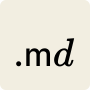

<p align="center">
  
</p>

<h1 align="center">MD Reader</h1>

<p align="center">
  Markdown reader & editor. Single HTML file, zero dependencies.<br>
  <strong><a href="https://eosycx.github.io/md-reader/md-reader.html">Open in browser</a></strong>
</p>

## Features

- Drag & drop or `Cmd+O` to open `.md` / `.txt` files; `Cmd+S` saves back to the original file (Chrome)
- Side-by-side preview + source editor with draggable split ratio
- WYSIWYG editing in preview mode: `Cmd+B` bold, `Cmd+I` italic, and more
- `Cmd+Z` undo, `Cmd+Shift+Z` redo
- Light / dark theme, follows system preference
- Local image rendering with reusable folder authorization and a persistent image cache
- Auto-continuing lists, Tab indent, scroll sync, word count

## Keyboard Shortcuts

| Action | Shortcut |
|--------|----------|
| Open file | `Cmd+O` |
| Save file | `Cmd+S` |
| Bold | `Cmd+B` |
| Italic | `Cmd+I` |
| Inline code | `Cmd+E` |
| Strikethrough | `Cmd+Shift+X` |
| Link | `Cmd+K` |
| Heading 1–3 | `Cmd+Opt+1/2/3` |
| Unordered list | `Cmd+Shift+8` |
| Ordered list | `Cmd+Shift+7` |
| Task list | `Cmd+Shift+9` |
| Quote | `Cmd+Shift+.` |
| Code block | `Cmd+Opt+C` |
| Split / Preview / Source | `Cmd+1/2/3` |

## Offline / Desktop

Download [`md-reader.html`](md-reader.html) and open in any browser. Works fully offline.

<details>
<summary>macOS Desktop App (with "Open With" support)</summary>

Requirements: macOS, Python 3, and Google Chrome (recommended; the launcher falls back to the default browser).

Build the app bundle from source:

```bash
./build-macos.sh
open "dist/MD Reader.app"
```

The build is for local use and is not Developer ID signed or notarized for distribution through the Mac App Store. To install it for your account and register `.md` files:

```bash
cp -R "dist/MD Reader.app" "$HOME/Applications/MD Reader.app"
/System/Library/Frameworks/CoreServices.framework/Frameworks/LaunchServices.framework/Support/lsregister -f "$HOME/Applications/MD Reader.app"
```

After building, you can:
- Right-click any `.md` file → **Open With** → **MD Reader**
- Set it as the **default app** for `.md` files (Get Info → Open with → Change All)
- Open from terminal: `open -a "MD Reader" file.md`

</details>

## License

[MIT](LICENSE), eosycx × Claude Code
